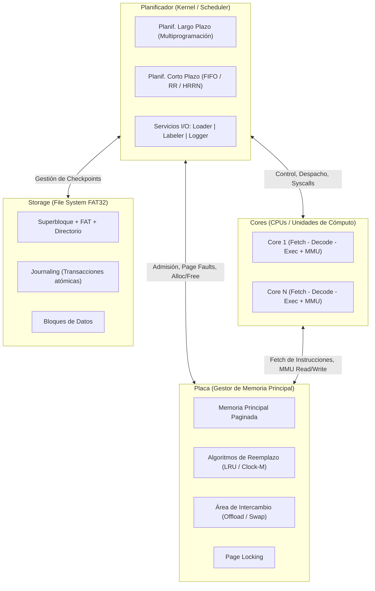

# Distributed OS Simulator

Simulador de un **Sistema Operativo Distribuido** desarrollado en C sobre entornos Linux/POSIX, orientado a la orquestación, gestión de memoria virtual y ejecución concurrente de trabajos (*Jobs*) de procesamiento y entrenamiento matricial (simulación de cargas de Machine Learning e Inteligencia Artificial).

El proyecto modela los componentes fundamentales de un sistema operativo real: planificación multinivel de procesos a corto y largo plazo, procesadores multinúcleo con traducción de direcciones (MMU), memoria virtual paginada bajo demanda con algoritmos de reemplazo y swapping (*Offload*), y un sistema de archivos persistente tipo FAT32 con soporte de *Journaling* y recuperación atómica ante caídas.

---

## 🏛️ Arquitectura del Sistema

El sistema opera de forma distribuida a través de procesos independientes que se comunican mediante sockets TCP con un protocolo binario de paquetes serializados:



---

## 📦 Módulos del Proyecto

### 1. Planificador (`planificador/`)
Actúa como el **Kernel del sistema operativo**, administrando el ciclo de vida de los Jobs (`NEW`, `READY`, `EXEC`, `BLOCKED`, `EXIT`) y coordinando las solicitudes entre módulos:
- **Planificación de Largo Plazo**: Controla el grado de multiprogramación (`GRADO_MULTIPROGRAMACION`). Admite Jobs desde la cola de `NEW` hacia `READY` a medida que se libera espacio.
- **Planificación de Corto Plazo**: Despacha Jobs hacia los Cores disponibles aplicando diferentes políticas configurables:
  - **FIFO** (First-In, First-Out).
  - **Round Robin (RR)**: Desalojo preventivo controlado por un *quantum* temporal (`RR_QUANTUM`).
  - **HRRN (Highest Response Ratio Next)**: Priorización dinámica no apropiativa basada en la tasa de respuesta:
    $$R = \frac{W + S}{S}$$
    donde $W$ es el tiempo de espera en `READY` y $S$ es la ráfaga estimada mediante promedio exponencial con factor $\alpha$ (`HRRN_ALFA`):
    $$S_{n+1} = \alpha \cdot t_n + (1 - \alpha) \cdot S_n$$
- **Servicios de Entrada/Salida (I/O)**:
  - **Loader (`LOAD_BATCH`)**: Carga bloques de datos desde archivos en disco a la memoria del Job aplicando retardos simulados.
  - **Labeler (`LABEL`)**: Permite la interacción por consola para etiquetado manual de datos.
  - **Logger/Report (`REPORT`)**: Genera reportes métricos y volcados de estado.
- **Gestión de Checkpoints**: Coordina el guardado y recuperación del estado de memoria de los Jobs comunicándose con el módulo Storage.
- **Atención de Page Faults**: Recibe los fallos de página reportados por los Cores, bloquea el Job solicitante y coordina con la Placa la carga del marco antes de devolverlo a `READY`.
- **Métricas y Estadísticas**: Al finalizar cada Job, emite métricas completas de tiempo total, tiempos en cada estado, uso máximo de memoria, conteo de syscalls y page faults.

### 2. Core (`core/`)
Representa una **unidad de procesamiento / procesador**. Permite instanciar múltiples Cores en paralelo conectándose simultáneamente al Planificador y a la Placa:
- **Ciclo de Instrucción**:
  1. **Fetch**: Solicita la siguiente instrucción a la Placa a partir del *Program Counter* (PC).
  2. **Decode**: Interpreta la operación, valida registros y sintaxis.
  3. **Execute**: Ejecuta operaciones locales o emite pedidos de syscall al Planificador.
- **Banco de Registros**:
  - `PC`: Program Counter.
  - `AX`, `BX`, `CX`, `DX`: Registros de propósito general.
  - `P0` a `P5`: Parámetros y pesos para entrenamiento.
  - `E1`, `E2`, `E3`: Registros de operandos de entrada/salida para cómputo matricial.
- **Unidad de Manejo de Memoria (MMU)**:
  - Traduce direcciones lógicas a direcciones físicas dividiendo en número de página y desplazamiento (*offset*).
  - Maneja accesos contiguos que cruzan fronteras de página dividiéndolos en pares físicos (`dir_fisica`, `tamanio`).
  - Detecta **Page Faults** cuando la página no se encuentra cargada en memoria y cede el control al Planificador.

### 3. Placa (`placa/`)
Simula el **subsistema de memoria principal física y acelerador de cómputo**:
- **Memoria Virtual Paginada Bajo Demanda**:
  - Divide la memoria física en marcos (*frames*) de tamaño fijo (`TAM_PAGINA`).
  - Mantiene las tablas de páginas por Job.
- **Espacio de Intercambio (Offload / Swapping)**:
  - Archivo de respaldo en disco (`offload.dat`) administrado mediante un mapa de bits (*bitmap*) de slots.
- **Algoritmos de Reemplazo de Páginas**:
  - **LRU (Least Recently Used)**: Desaloja la página cuyo último acceso fue el más antiguo en el tiempo.
  - **Clock Modificado (Clock-M)**: Algoritmo de dos pasadas evaluando bits de uso (`U`) y modificación (`M`):
    - Paso 1: Busca $(0, 0)$ sin modificar bits.
    - Paso 2: Busca $(0, 1)$ cambiando el bit de uso $U \to 0$.
- **Page Locking**: Bloquea marcos en memoria durante operaciones de E/S o traducción activa para evitar que sean seleccionados como víctimas de reemplazo.
- **Consola Interactiva**:
  - `INFO`: Muestra porcentaje de ocupación de memoria, cantidad de marcos libres, lockeados y estado del Offload.
  - `TLS`: Lista la tabla de páginas y asignaciones vigentes de todos los Jobs activos.

### 4. Storage (`storage/`)
Módulo de **persistencia y almacenamiento masivo**:
- **File System FAT32 (`FAT32_TRAIN`)**:
  - Implementación sobre un archivo mapeado en memoria vía `mmap`.
  - Estructura interna:
    - **Superbloque** (Bloque 0): Identificador (`FAT32_TRAIN`), tamaño de bloque, cantidad de bloques y bloques de directorio.
    - **FAT (File Allocation Table)**: Tabla de asignación de bloques enlazados, marcas de fin de archivo (`0x0FFFFFFF`) y bloques libres (`0x00000000`).
    - **Directorio Raíz**: Entradas de 32 bytes con nombre de archivo, tamaño, bloque inicial y estado.
    - **Área de Datos**: Bloques físicos asignados a los archivos.
- **Journaling y Recuperación ante Fallos**:
  - Registro de transacciones atómicas de tipo *Write-Ahead Logging* en `journal.txt`.
  - Cada operación desglosa modificaciones idempotentes sobre el directorio, la FAT y los bloques de datos.
  - Solo tras escribir el `COMMIT` en el journal se aplican los cambios al volumen.
  - Al reiniciar el módulo, escanea el journal y **reaplica automáticamente** aquellas transacciones con `COMMIT` que hayan quedado interrumpidas (`RECORD_APPLIED`).
- **Consola de Control**:
  - `INFO`: Detalle del superbloque y geometría del File System.
  - `LS`: Listado exhaustivo de entradas del directorio (libres y ocupadas).
  - `CAT <nombre> <bytes>`: Visualización del contenido en hexadecimal.
  - `WRITE <nombre> <hex_data>`: Escritura manual de un archivo de prueba.
  - `RM <nombre>`: Eliminación de un archivo liberando su cadena en la FAT.

### 5. Utils (`utils/`)
Biblioteca compartida con los componentes comunes del sistema:
- Gestión de sockets cliente/servidor multihilo con multiplexación.
- Protocolo de paquetes binarios serializados (`op_code`, payloads, buffers dinámicos).
- Estructuras comunes de contexto de CPU y códigos de retorno.

---

## 💻 Repertorio de Instrucciones (ISA)

Los Jobs se escriben en un lenguaje de pseudocódigo que soporta operaciones aritméticas, control de flujo, entrenamiento y llamadas al sistema:

| Instrucción | Parámetros | Descripción |
| :--- | :--- | :--- |
| `NOOP` | - | No realiza operación. |
| `SET` | `[Reg] [Valor/Reg]` | Asigna un valor inmediato o el contenido de otro registro en `[Reg]`. |
| `SUM` | `[Reg] [Valor/Reg]` | Suma un valor o registro al contenido de `[Reg]`. |
| `SUB` | `[Reg] [Valor/Reg]` | Resta un valor o registro al contenido de `[Reg]`. |
| `JNZ` | `[Reg] [Instrucción]` | Salto condicional al número de instrucción (PC) si `[Reg] != 0`. |
| `INIT_JOB` | `[Archivo]` | Solicita al Planificador la creación y admisión de un nuevo Job. |
| `EXIT` | - | Finaliza la ejecución del Job actual y libera sus recursos. |
| `ALLOC` | `[Reg] [Tamaño]` | Reserva memoria virtual; almacena en `[Reg]` la dirección lógica base. |
| `FREE` | `[Dirección/Reg]` | Libera el bloque de memoria previamente asignado. |
| `FORWARD` | `[Dir1] [Dir2] [Dir3] [Reg]` | Multiplica operandos en memoria ($E_1 \times E_2$) y acumula el producto en `[Reg]`. |
| `BACKWARD` | `[Dir1] [Dir2] [Dir3] [Reg]` | Multiplica operandos en memoria ($E_1 \times E_2$) y sustrae el producto de `[Reg]`. |
| `UPDATE` | `[Dir1] [Dir2] [Dir3]` | Actualiza pesos en memoria: $E_2 \leftarrow (E_2 + E_1)/2$ y $E_3 \leftarrow E_3 - E_2$. |
| `LOAD_BATCH` | `[Archivo] [Dir] [Tam]` | Syscall bloqueante: carga `[Tam]` bytes del archivo a memoria. |
| `LABEL` | `[Dir] [Tam]` | Syscall bloqueante: solicita `[Tam]` caracteres desde la consola. |
| `REPORT` | `[Dir] [Tam]` | Syscall bloqueante: registra en el archivo de reportes los datos de memoria. |
| `SAVE_CHECKPOINT` | `[Nombre] [Dir] [Tam]` | Guarda en Storage un snapshot de `[Tam]` bytes de memoria. |
| `LOAD_CHECKPOINT` | `[Nombre] [Dir] [Tam]` | Recupera desde Storage un checkpoint hacia la memoria del Job. |
| `DELETE_CHECKPOINT` | `[Nombre]` | Elimina un checkpoint almacenado en el File System. |

---

## 🛠️ Requisitos y Compilación

### Dependencias
- Compilador **GCC** con soporte C11/POSIX.
- Herramienta de compilación **Make**.
- Biblioteca **[so-commons-library](https://github.com/sisoputnfrba/so-commons-library)** de la cátedra de Sistemas Operativos (UTN-FRBA).
- Biblioteca GNU **Readline** (`libreadline-dev`).

Instalación de la biblioteca Commons:
```bash
git clone https://github.com/sisoputnfrba/so-commons-library
cd so-commons-library
make install
```

### Compilación de los módulos
Cada módulo posee su propio `Makefile`. La biblioteca común `utils` debe compilarse previamente:

```bash
# 1. Compilar biblioteca compartida utils
cd utils
make
sudo make install # o incluir libutils en LD_LIBRARY_PATH
cd ..

# 2. Compilar el resto de los módulos
cd storage && make && cd ..
cd placa && make && cd ..
cd planificador && make && cd ..
cd core && make && cd ..
```

---

## 🚀 Puesta en Marcha

Para iniciar el entorno completo, se recomienda ejecutar los módulos en el siguiente orden:

1. **Storage**:
   ```bash
   cd storage
   ./bin/storage storage.config
   ```

2. **Placa**:
   ```bash
   cd placa
   ./bin/placa placa.config
   ```

3. **Planificador**:
   ```bash
   cd planificador
   ./bin/planificador planificador.config scripts/init_job.txt
   ```
   *(Requiere especificar el archivo de configuración y la ruta del script del Job inicial).*

4. **Cores** (se pueden iniciar una o más instancias):
   ```bash
   cd core
   ./bin/core core.config 1
   ```
   *(Argumentos: archivo de configuración e identificador único del Core).*

---

## ⚙️ Archivos de Configuración

Cada módulo dispone de un archivo `.config` con parámetros ajustables:

- **`planificador.config`**: Algoritmo de planificación (`FIFO`, `RR`, `HRRN`), valor de quantum (`RR_QUANTUM`), alfa de HRRN (`HRRN_ALFA`), estimación inicial, grado de multiprogramación y rutas de I/O.
- **`placa.config`**: Tamaño de memoria física (`TAM_MEMORIA`), tamaño de página (`TAM_PAGINA`), algoritmo de reemplazo (`LRU` o `CLOCK-M`), tamaño y retardo de Offload.
- **`storage.config`**: Cantidad y tamaño de bloques (`CANT_BLOQUES`, `TAM_BLOQUE`), bloques asignados al directorio, retardos simulados de acceso a bloque y commit.
- **`core.config`**: IPs y puertos de conexión al Planificador y a la Placa, nivel de logging.
